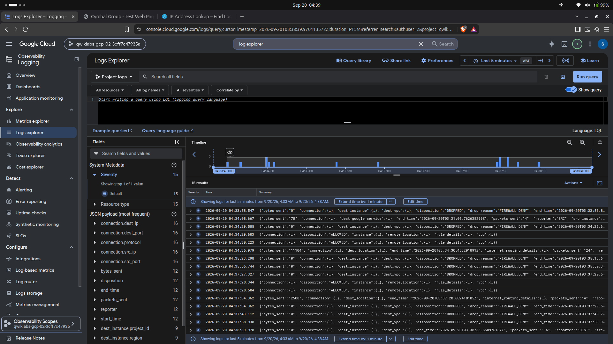

# 📊 Google Cloud – Logs Explorer (`05-logs-explorer-vpc-flow-logs`)

**Console:** Google Cloud · Observability · Logging · Logs explorer  
**Project:** `qwiklabs-gcp-02-3cff7c47935a`  
**Language:** `LQL`  
**Time Range:** `Last 5 minutes` (`WAT`) — `9/20/26, 4:33 AM to 9/20/26, 4:38 AM`

---

## 🔎 Fields & Query Results

**Results:** `15 results`

### System Metadata

- **Severity:** `Default` (`15`)
- **Resource type:** `15`

### JSON Payload (Most Frequent)

| Field | Count |
| :--- | :--- |
| `connection.dest_ip` | `16` |
| `connection.dest_port` | `16` |
| `connection.protocol` | `16` |
| `connection.src_ip` | `16` |
| `connection.src_port` | `16` |
| `bytes_sent` | `12` |
| `disposition` | `12` |
| `end_time` | `12` |
| `packets_sent` | `12` |
| `reporter` | `12` |
| `start_time` | `12` |
| `dest_instance.project_id` | `9` |
| `dest_instance.region` | `9` |

### Log Dispositions Observed

- `"disposition":"DROPPED","drop_reason":"FIREWALL_DENY"`
- `"disposition":"ALLOWED"`
