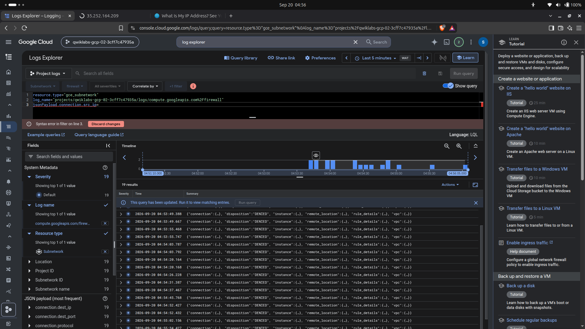

# 🚫 Google Cloud – Logs Explorer (`07-firewall-denied-logs`)

**Console:** Google Cloud · Observability · Logging · Logs explorer  
**Project:** `qwiklabs-gcp-02-3cff7c47935a`  
**Language:** `LQL`  
**Time Range:** `Last 5 minutes` (`WAT`) — `04:51:10.000 to 04:56:05.000`



---

## 💻 LQL Query & Filter State

```text
resource.type="gce_subnetwork"
log_name="projects/qwiklabs-gcp-02-3cff7c47935a/logs/compute.googleapis.com%2Ffirewall"
jsonPayload.connection.src_ip=
```

> **Error:** `Syntax error in filter on line 3.`

### Active Filters

| Filter | Value | Count |
| :--- | :--- | :--- |
| **Severity** | `Default` | `19` |
| **Log name** | `compute.googleapis.com/firewall` | `19` |
| **Resource type** | `Subnetwork` | `19` |

---

## 📋 Results

**Results:** `19 results` (`2026-09-20 04:53:49.388` to `2026-09-20 04:55:34.427`)

All visible log entries report:

- `"disposition":"DENIED"`
