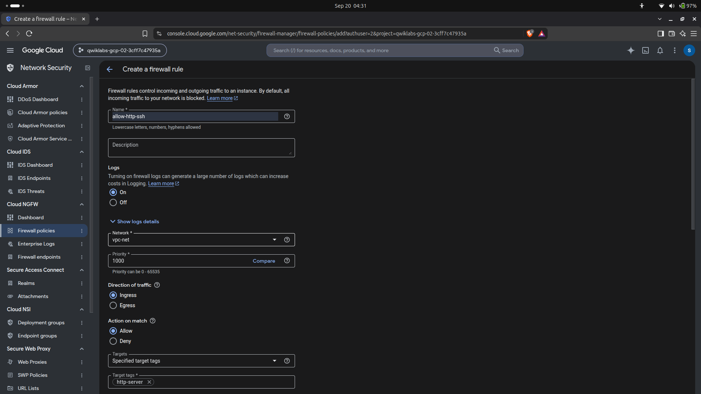

# 🔥 Google Cloud – Create a Firewall Rule (`02-create-rule-basic-settings`)

**Console:** Google Cloud · Network Security · Cloud NGFW · Firewall policies  
**Project:** `qwiklabs-gcp-02-3cff7c47935a`

Firewall rules control incoming and outgoing traffic to an instance. By default, all incoming traffic to your network is blocked.

---

## ⚙️ Rule Configuration

| Setting | Value | Notes |
| :--- | :--- | :--- |
| **Name** | `allow-http-ssh` | Lowercase letters, numbers, hyphens allowed |
| **Description** | — | — |
| **Logs** | `On` | Turning on firewall logs can generate a large number of logs which can increase costs in Logging. |
| **Network** | `vpc-net` | — |
| **Priority** | `1000` | Priority can be 0 - 65535 |
| **Direction of traffic** | `Ingress` | — |
| **Action on match** | `Allow` | — |
| **Targets** | `Specified target tags` | — |
| **Target tags** | `http-server` | — |
