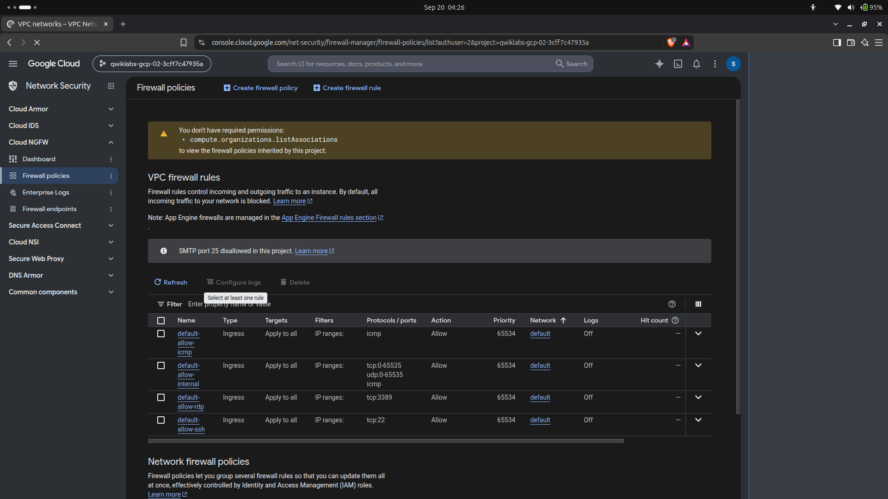

# 🛡️ Google Cloud – VPC Firewall Rules (`01-default-firewall-rules`)

**Console:** Google Cloud · Network Security · Cloud NGFW · Firewall policies  
**Project:** `qwiklabs-gcp-02-3cff7c47935a`

---

## ⚠️ Permissions Notice

> You don't have required permissions:
> - `compute.organizations.listAssociations`
>
> to view the firewall policies inherited by this project.

---

## 🔥 VPC Firewall Rules

Firewall rules control incoming and outgoing traffic to an instance. By default, all incoming traffic to your network is blocked.

> **Note:** App Engine firewalls are managed in the App Engine Firewall rules section.  
> **Info:** SMTP port 25 disallowed in this project.

### Default Rules

| Name | Type | Targets | Filters | Protocols / ports | Action | Priority | Network | Logs | Hit count |
| :--- | :--- | :--- | :--- | :--- | :--- | :--- | :--- | :--- | :--- |
| `default-allow-icmp` | Ingress | Apply to all | IP ranges: | `icmp` | Allow | `65534` | `default` | Off | — |
| `default-allow-internal` | Ingress | Apply to all | IP ranges: | `tcp:0-65535`, `udp:0-65535`, `icmp` | Allow | `65534` | `default` | Off | — |
| `default-allow-rdp` | Ingress | Apply to all | IP ranges: | `tcp:3389` | Allow | `65534` | `default` | Off | — |
| `default-allow-ssh` | Ingress | Apply to all | IP ranges: | `tcp:22` | Allow | `65534` | `default` | Off | — |

---

## 📋 Network Firewall Policies

Firewall policies let you group several firewall rules so that you can update them all at once, effectively controlled by Identity and Access Management (IAM) roles.
