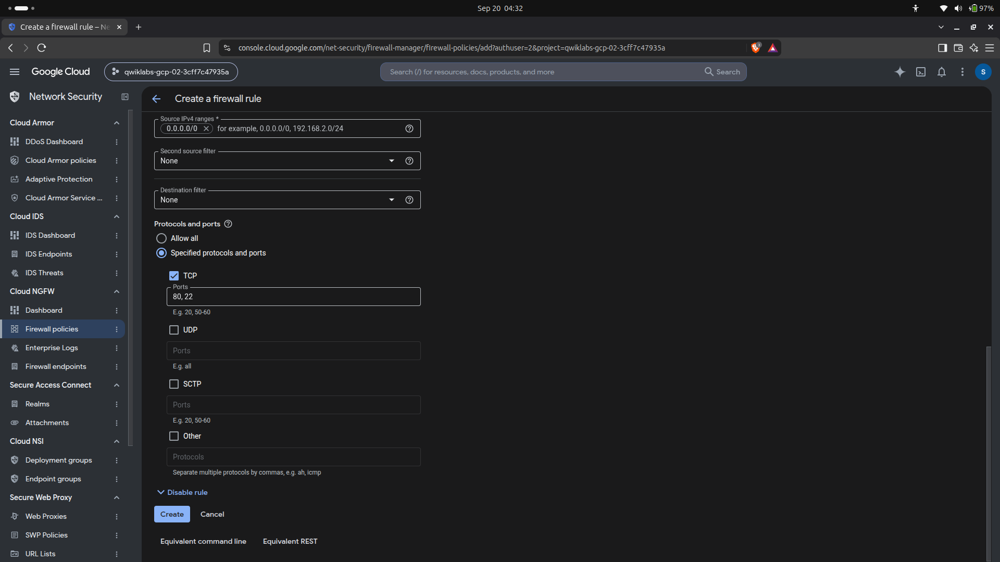

# 🔥 Google Cloud – Create a Firewall Rule (`03-create-rule-ports-protocols`)

**Console:** Google Cloud · Network Security · Cloud NGFW · Firewall policies  
**Project:** `qwiklabs-gcp-02-3cff7c47935a`

---

## ⚙️ Source, Destination, Protocols & Ports

| Setting | Value | Notes |
| :--- | :--- | :--- |
| **Source IPv4 ranges** | `0.0.0.0/0` | for example, `0.0.0.0/0`, `192.168.2.0/24` |
| **Second source filter** | `None` | — |
| **Destination filter** | `None` | — |
| **Protocols and ports** | `Specified protocols and ports` | — |
| **TCP** | Checked — Ports: `80, 22` | E.g. 20, 50-60 |
| **UDP** | Unchecked | — |
| **SCTP** | Unchecked | — |
| **Other** | Unchecked | — |
