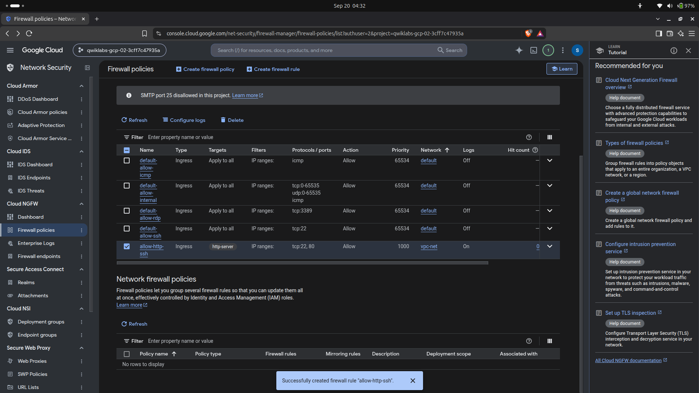

# ✅ Google Cloud – Firewall Rule Created (`04-rule-created-confirmation`)

**Console:** Google Cloud · Network Security · Cloud NGFW · Firewall policies  
**Project:** `qwiklabs-gcp-02-3cff7c47935a`

---

## 🎉 Confirmation & Notice

> **Confirmation:** Successfully created firewall rule `"allow-http-ssh"`.  
> **Info:** SMTP port 25 disallowed in this project.

---

## 🔥 VPC Firewall Rules

| Name | Type | Targets | Filters | Protocols / ports | Action | Priority | Network | Logs | Hit count |
| :--- | :--- | :--- | :--- | :--- | :--- | :--- | :--- | :--- | :--- |
| `default-allow-icmp` | Ingress | Apply to all | IP ranges: | `icmp` | Allow | `65534` | `default` | Off | — |
| `default-allow-internal` | Ingress | Apply to all | IP ranges: | `tcp:0-65535`, `udp:0-65535`, `icmp` | Allow | `65534` | `default` | Off | — |
| `default-allow-rdp` | Ingress | Apply to all | IP ranges: | `tcp:3389` | Allow | `65534` | `default` | Off | — |
| `default-allow-ssh` | Ingress | Apply to all | IP ranges: | `tcp:22` | Allow | `65534` | `default` | Off | — |
| `allow-http-ssh` | Ingress | `http-server` | IP ranges: | `tcp:22, 80` | Allow | `1000` | `vpc-net` | On | `0` |

---

## 📋 Network Firewall Policies

Firewall policies let you group several firewall rules so that you can update them all at once, effectively controlled by Identity and Access Management (IAM) roles.

*No rows to display*
