# AuthShield 360

**Identity, Authentication & Access Control for an Academic Portal**

`TECHWIZ 7 | PROJECT DOCUMENTATION`

OpenID Connect • Role-Based Access Control • TOTP Multi-Factor Authentication • Brute-Force Protection • Password Recovery

**Author:** Muhammed Abdulazeez  
**Document:** Implementation & Security Verification Report  
**Date:** 29 September 2026  
**Repository:** `github.com/muhammedabdulazeez/authshield`

---

## 1. Executive Summary

AuthShield 360 is a containerised identity and access management solution for a fictional school, Apex Digital Academy. It places a Flask web portal *(the relying party)* behind Keycloak 24 *(the identity provider)* using the OpenID Connect (OIDC) authorization-code flow. Users never enter passwords into the portal itself: authentication, multi-factor enrolment, lockout and password recovery are all handled by Keycloak, and the portal only consumes the resulting tokens.

The project demonstrates five security capabilities, each verified with screenshots taken from the running system:

- **Single sign-on** with OIDC between the portal and Keycloak, including RP-initiated logout.
- **Role-based access control (RBAC)** with three roles (Student, Teacher, Administrator) enforced on portal routes.
- **Multi-factor authentication** using RFC 6238 time-based one-time passwords (TOTP), enforced through a Keycloak required action.
- **Brute-force protection** that temporarily locks an account after repeated failed sign-ins.
- **Password recovery** through an email link, delivered to a local MailHog SMTP sink for safe testing.

All nine planned test cases passed. The report also records limitations found during review (Section 8) and how each would be addressed before any production use.

---

## 2. Objectives and Scope

- Centralise authentication so that the portal never stores or validates credentials.
- Restrict sensitive pages (examination grades, administration console) to the roles that need them (least privilege).
- Add a second authentication factor and protect accounts against password guessing.
- Provide a working, reproducible environment (Docker Compose) and documented evidence of every control.

**Out of scope:** production TLS, an external database, real email delivery, and a real audit-log backend. These are listed under future work.

---

## 3. Technology Stack

| Component | Technology | Purpose |
| :--- | :--- | :--- |
| Identity Provider | Keycloak 24.0 (`start-dev` mode) | OIDC provider, user store, roles, TOTP, brute-force detection, password reset |
| Relying Party | Python 3 / Flask, `requests` | Login redirect, token exchange, session handling, route-level RBAC |
| Mail sink | MailHog | Captures reset emails (SMTP 1025, web UI 8025) |
| Front end | Jinja2 templates, Tailwind CSS, Lucide icons | Portal pages: home, records, grades, admin console |
| Packaging | Docker and Docker Compose | Three services on network `authshield-net`; named volume `keycloak_v2_data` |
| Source control | Git / GitHub | `github.com/muhammedabdulazeez/authshield` |

---

## 4. System Architecture

```text
+-----------------------+   1. request page    +------------------------------+
|    User / Browser     | -------------------> |      Flask Portal (RP)       |
| student, teacher,     |                      | school-portal client :5000   |
| admin                 |                      +------------------------------+
+-----------------------+                                     |
            |                                                 | 3. code -> token exchange
            | 2. login + TOTP (OIDC)                          |    (back channel)
            v                                                 v
+-------------------------------+   reset mail   +------------------------------+
|       Keycloak 24 (IdP)       | -------------> |           MailHog            |
| realm: authshield :8080       |                | SMTP :1025 / UI :8025        |
+-------------------------------+                +------------------------------+

All three containers share the Docker bridge network 'authshield-net'.
```

*Figure 1. Service topology of AuthShield 360.*

### Authentication flow (OIDC authorization code)

- The user opens the portal. Protected routes redirect anonymous users to `/login`.
- The portal redirects the browser to the Keycloak authorization endpoint (realm `authshield`, client `school-portal`) with `prompt=login`.
- Keycloak authenticates the user (password, then TOTP) and redirects back to `/callback` with a one-time authorization code.
- The portal exchanges the code for tokens on the **back channel**, authenticating with its client secret.
- The portal reads the token claims (`username`, `resource_access.school-portal.roles`) into the session and applies RBAC.
- `/logout` clears the portal session and calls the Keycloak end-session endpoint so the SSO session is also closed.

---

## 5. Implementation

### 5.1 Keycloak realm

| Item | Configuration |
| :--- | :--- |
| Realm / client | `authshield` / `school-portal` (confidential client, authorization-code flow) |
| Client roles | `Student`, `Teacher`, `Administrator` (read from the `resource_access` claim) |
| Users | `student1` (Student), `teacher1` (Teacher), `admin1` (Administrator) |
| MFA | Required action *Configure OTP*: users must register an authenticator app before their first session |
| Brute-force detection | Enabled: repeated failures put the account in a temporary lockout |
| Email | SMTP relay pointed at the MailHog container for password-reset messages |

### 5.2 Portal routes and access policy

| Route | Purpose | Required role | Denied response |
| :--- | :--- | :--- | :--- |
| `/` | Home hub; shows the signed-in user | Any (login for modules) | — |
| `/records` | Student enrolment registry | Any authenticated user | Redirect to `/login` |
| `/grades` | Continuous assessment and exam ledger | Teacher or Administrator | `403 Forbidden` |
| `/admin-console` | Administrative / SOC console | Administrator | `403 Forbidden` |

### 5.3 Deployment

The complete stack starts with one command and needs only Docker Compose v2:

`docker compose up -d` (`portal :5000`, `Keycloak :8080`, `MailHog :8025`). The portal image is rebuilt with `docker compose up -d --build school-portal` and the stack is stopped with `docker compose down`.

---

## 6. Security Controls and Threat Model

| Threat | Attack vector | Control implemented |
| :--- | :--- | :--- |
| Password guessing | Automated or manual repeated logins | Keycloak brute-force detection with temporary account lockout |
| Stolen credentials | Reused or phished password | Mandatory TOTP second factor |
| Privilege escalation | Student opening grades or admin pages by URL | Server-side role check on every restricted route (403 on failure) |
| Lingering sessions | SSO cookie left active after portal logout | OIDC RP-initiated logout ends the Keycloak session as well |
| Account recovery abuse | Attacker resets another user's password | Single-use reset link by email with a short expiry (5 minutes) |

---

## 7. Verification Results and Evidence

Each test case was run against the live Docker environment and captured as a screenshot. The matrix summarises the outcome; the figures that follow are the captured evidence.

| ID | Scenario | Identity | Action | Expected result | Result | Evidence |
| :--- | :--- | :--- | :--- | :--- | :--- | :--- |
| TC-01 | Universal access | `student1` | `GET /records` | `200 OK`, roster shown | PASS | Fig. 4 |
| TC-02 | RBAC boundary | `student1` | `GET /grades` | `403 Forbidden` | PASS | Fig. 5 |
| TC-03 | RBAC boundary | `student1` | `GET /admin-console` | `403 Forbidden` | PASS | Fig. 6 |
| TC-04 | Faculty access | `teacher1` | `GET /grades` | `200 OK`, ledger shown | PASS | Fig. 7 |
| TC-05 | Admin access | `admin1` | `GET /admin-console` | `200 OK`, console shown | PASS* | Fig. 17* |
| TC-06 | MFA enrolment | `student1` | First sign-in | Forced TOTP setup | PASS | Fig. 3 |
| TC-07 | Invalid OTP | `student1` | Submit wrong codes | `'Invalid authenticator code'` | PASS | Fig. 9-10 |
| TC-08 | Lockout | `admin1` | Repeated failed logins | Account temporarily locked | PASS | Fig. 12-13 |
| TC-09 | Recovery | `admin1` | Forgot password | Reset mail in MailHog; new password set | PASS | Fig. 14-17 |

*\* TC-05 is recorded as passed in the project test log. Fig. 17 shows the admin1 session; a dedicated capture of the /admin-console page (200 OK) is not yet in the evidence set and should be added.*

### 7.1 Sign-in and MFA enrolment

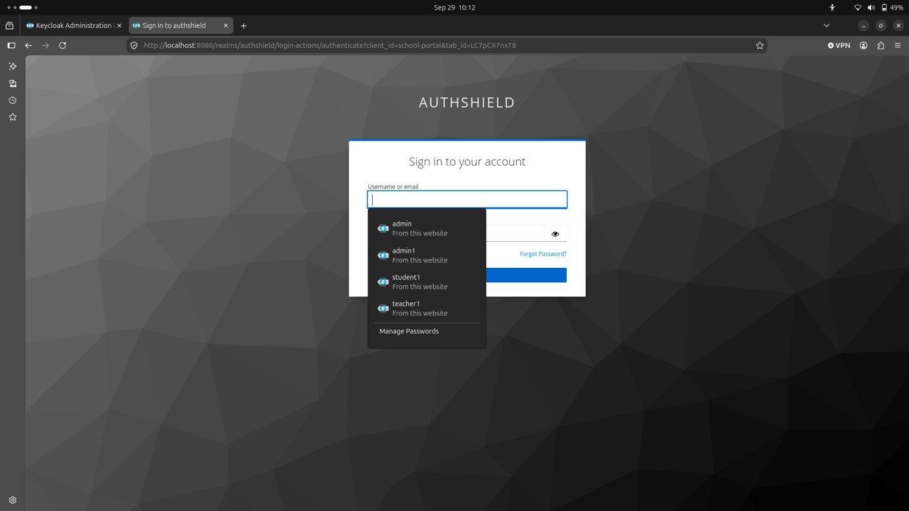

*Figure 2. Keycloak sign-in page for realm authshield, reached by redirect from the portal.*

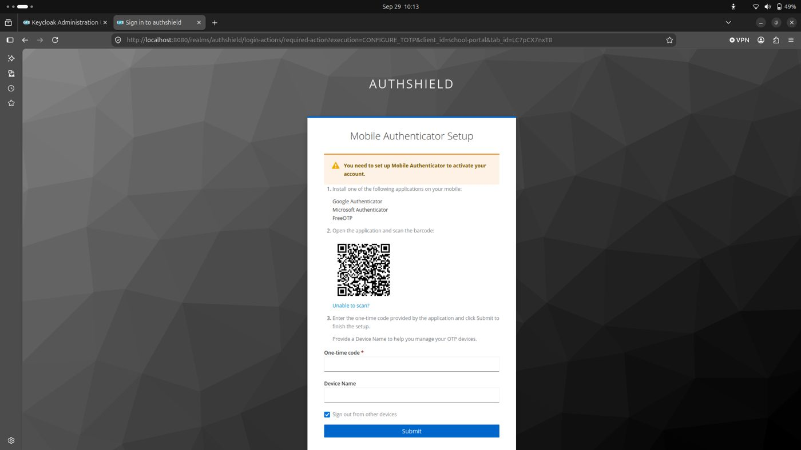

*Figure 3. TC-06: forced Mobile Authenticator setup (QR code, one-time code and device name) for a new user.*

### 7.2 Role-based access control

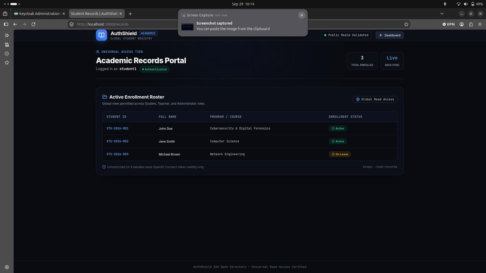

*Figure 4. TC-01: student1 can open the Academic Records page (200 OK).*

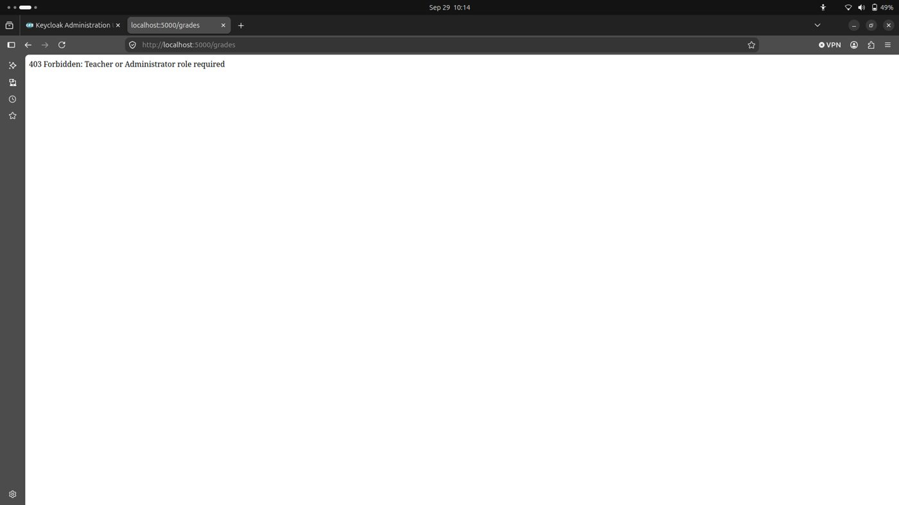

*Figure 5. TC-02: student1 requests /grades and receives 403 Forbidden.*


*Figure 6. TC-03: student1 requests /admin-console and receives 403 Forbidden.*

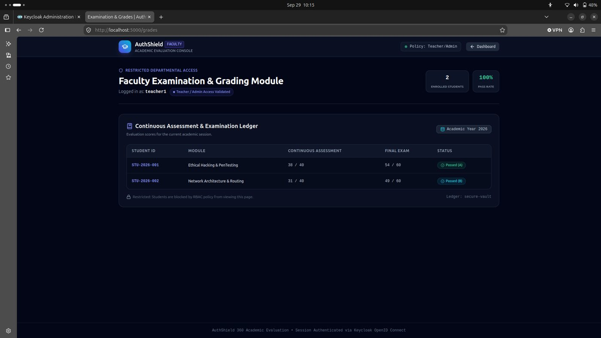

*Figure 7. TC-04: teacher1 opens the Faculty Examination and Grading module (200 OK).*


*Figure 8. Additional check: teacher1 is also denied the administration console (403 Forbidden).*

### 7.3 Multi-factor authentication

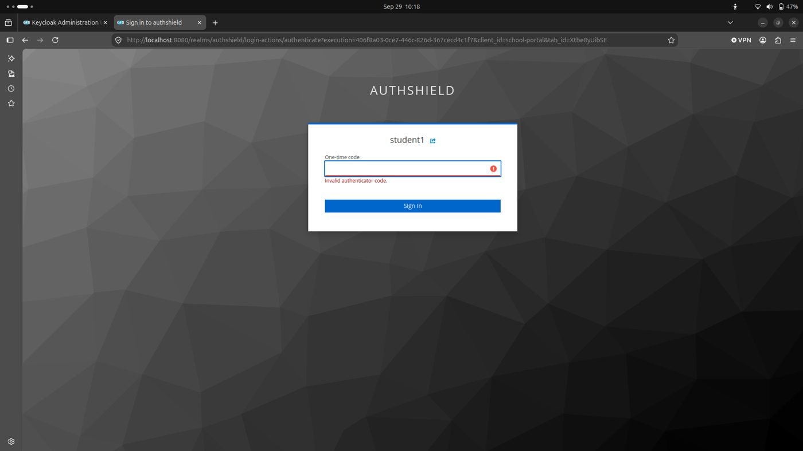

*Figure 9. TC-07: an invalid one-time code is rejected with 'Invalid authenticator code'.*


*Figure 10. TC-07: a second incorrect six-digit code is rejected in the same way.*

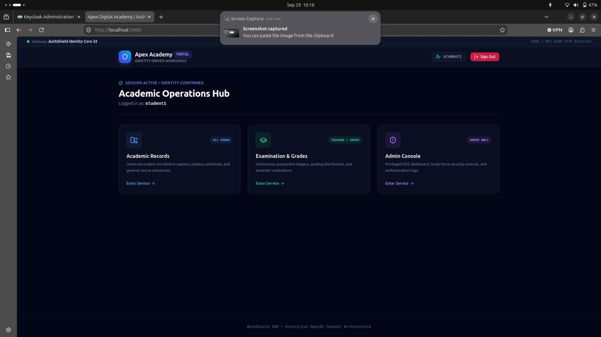

*Figure 11. After entering a valid code, student1 reaches the portal home page.*

### 7.4 Brute-force protection

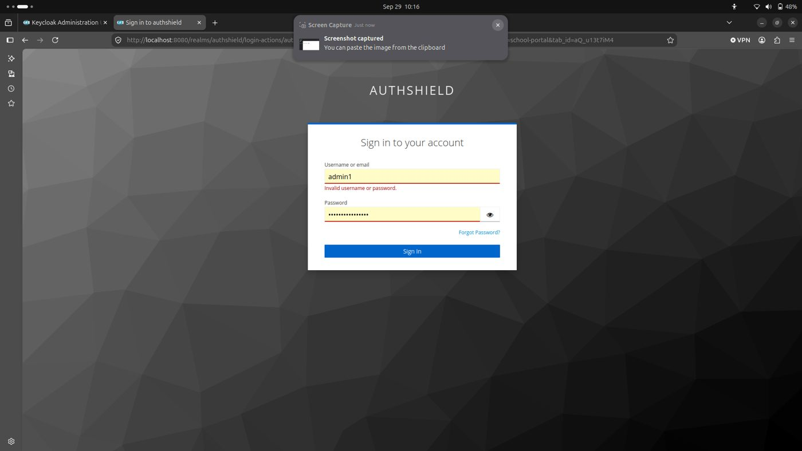

*Figure 12. TC-08: a failed sign-in for admin1 ('Invalid username or password').*

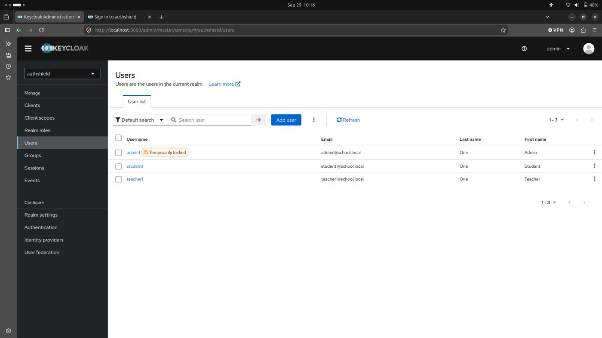

*Figure 13. TC-08: Keycloak Users list showing admin1 flagged Temporarily locked.*

### 7.5 Password recovery

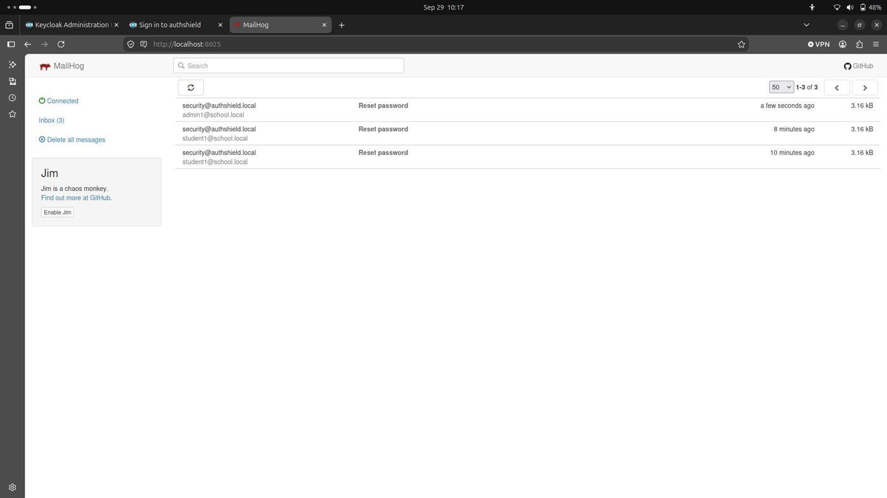

*Figure 14. TC-09: MailHog inbox holding the 'Reset password' emails sent by Keycloak.*

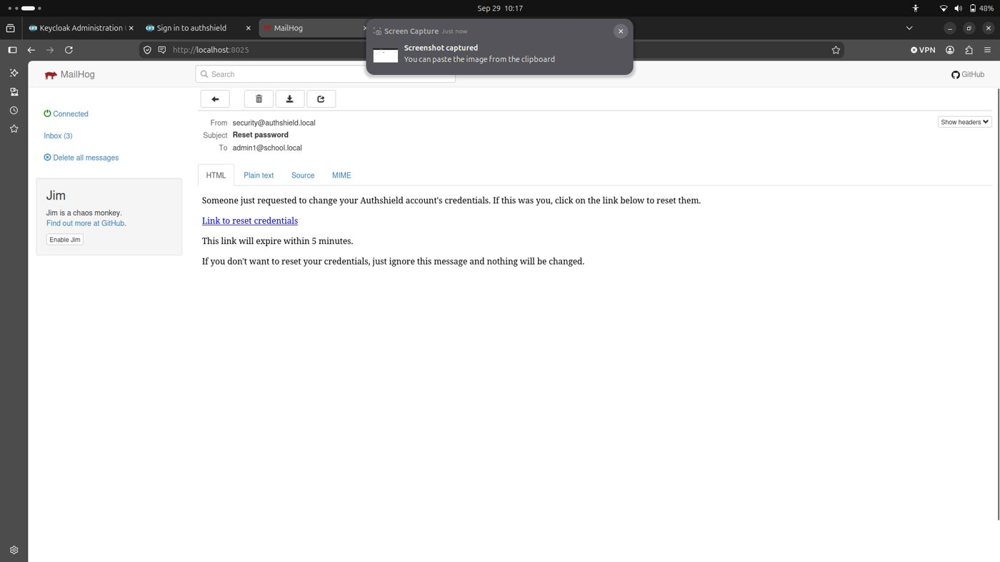

*Figure 15. TC-09: reset email with a link that expires within 5 minutes.*

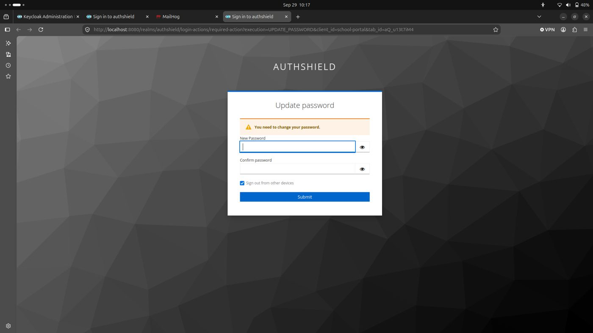

*Figure 16. TC-09: Keycloak 'Update password' page reached from the emailed link.*

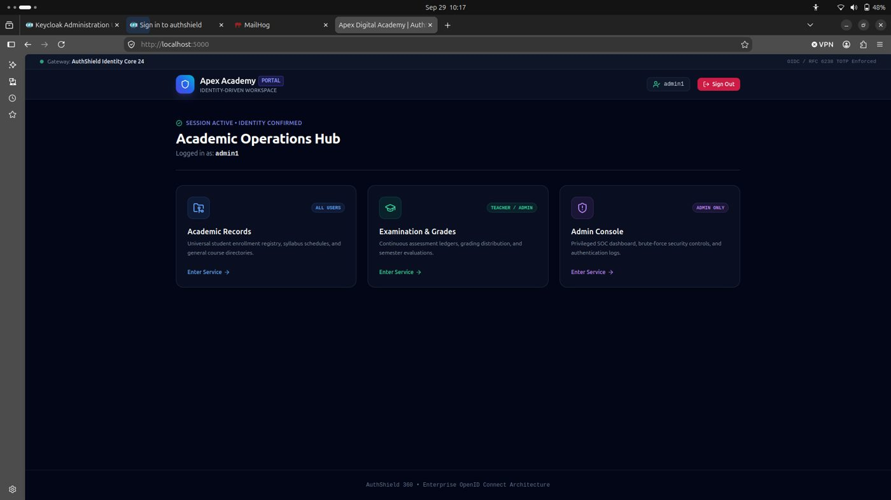

*Figure 17. TC-09: admin1 signed in to the portal after resetting the password.*

---

## 8. Findings and Limitations

A review of the code and configuration identified the following points. None affect the lab demonstration, but each should be resolved before real-world use.

| # | Finding | Impact | Recommended action |
| :--- | :--- | :--- | :--- |
| 1 | The portal decodes the JWT payload with base64 but does not verify the signature, issuer, audience or expiry. Tokens are obtained directly from Keycloak over the back channel, which limits exposure. | Medium | Validate tokens against Keycloak's JWKS endpoint (for example with Authlib or PyJWT) and check `iss`, `aud` and `exp`. |
| 2 | Client secret, Flask secret key and Keycloak admin password are hard-coded in `docker-compose.yml` and `app.py`, and the repository is public. | High | Rotate all three; load them from environment files excluded from Git or from a secret manager. |
| 3 | Keycloak runs in `start-dev` mode with the embedded H2 database and plain HTTP. | Medium | Use production mode, PostgreSQL and TLS behind a reverse proxy. |
| 4 | The admin console table is static sample data labelled 'Simulated', although the header text says 'Live Sync'. One row names an email step-up, whereas the implemented second factor is TOTP. | Low | Feed the page from the Keycloak Events API and align the wording. |
| 5 | Lockout evidence was captured on `admin1`, and the lockout threshold differs between draft documents (3 vs 4 attempts). | Low | Confirm the value in Realm settings, Security defenses, Brute force detection, and quote it here. |
| 6 | The session cookie uses default Flask settings. | Low | Set `Secure`, `HttpOnly` and `SameSite` cookie flags once served over HTTPS. |

---

## 9. Future Work

- Verify tokens cryptographically and add refresh-token handling and session timeouts.
- Replace the simulated audit table with real Keycloak event data.
- Deploy behind HTTPS with PostgreSQL persistence, and export the realm as version-controlled configuration.
- Add WebAuthn / passkeys as a phishing-resistant second factor.
- Automate the nine test cases (for example with Playwright) so the evidence can be regenerated.

---

## 10. Conclusion

AuthShield 360 shows how delegating authentication to a dedicated identity provider gives a small web application enterprise-grade controls with very little application code: role-based authorisation, enforced multi-factor authentication, account lockout and self-service password recovery. The recorded evidence confirms that each control behaves as designed in the lab environment, and the findings in Section 8 provide a clear path from this prototype towards a production-ready deployment.

---

## Appendix A. Evidence file index

| Figure | Original file (`proof/`) | Shows |
| :--- | :--- | :--- |
| Fig. 2 | `Screenshot From 2026-09-29 10-12-33.png` | Keycloak sign-in page |
| Fig. 3 | `Screenshot From 2026-09-29 10-13-12.png` | TOTP enrolment (TC-06) |
| Fig. 4 | `Screenshot From 2026-09-29 10-14-20.png` | student1 `/records` (TC-01) |
| Fig. 5 | `Screenshot From 2026-09-29 10-14-31.png` | student1 `/grades` 403 (TC-02) |
| Fig. 6 | `Screenshot From 2026-09-29 10-14-38.png` | student1 `/admin-console` 403 (TC-03) |
| Fig. 7 | `Screenshot From 2026-09-29 10-15-36.png` | teacher1 `/grades` (TC-04) |
| Fig. 8 | `Screenshot From 2026-09-29 10-15-45.png` | teacher1 `/admin-console` 403 |
| Fig. 9 | `Screenshot From 2026-09-29 10-18-13.png` | Invalid OTP (TC-07) |
| Fig. 10 | `Screenshot From 2026-09-29 10-18-40.png` | Invalid OTP (TC-07) |
| Fig. 11 | `Screenshot From 2026-09-29 10-18-45.png` | student1 portal home after valid OTP |
| Fig. 12 | `Screenshot From 2026-09-29 10-16-57.png` | Failed login (TC-08) |
| Fig. 13 | `Screenshot From 2026-09-29 10-16-50.png` | admin1 temporarily locked (TC-08) |
| Fig. 14 | `Screenshot From 2026-09-29 10-17-12.png` | MailHog inbox (TC-09) |
| Fig. 15 | `Screenshot From 2026-09-29 10-17-17.png` | Reset email (TC-09) |
| Fig. 16 | `Screenshot From 2026-09-29 10-17-26.png` | Update password page (TC-09) |
| Fig. 17 | `Screenshot From 2026-09-29 10-17-50.png` | admin1 signed in after reset (TC-09) |

*Two further captures (a Google Skills lab page and a repeat of the 403 page) are in `proof/` but are not used in this report.*
