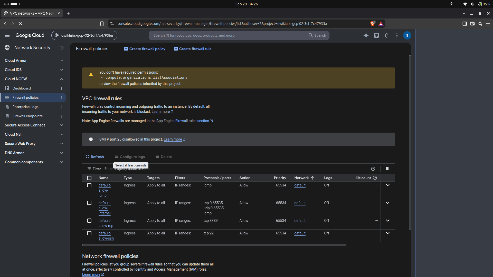
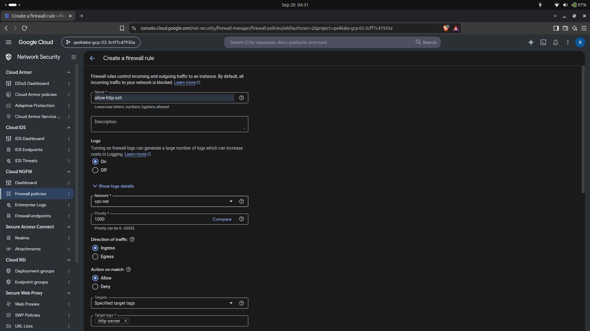
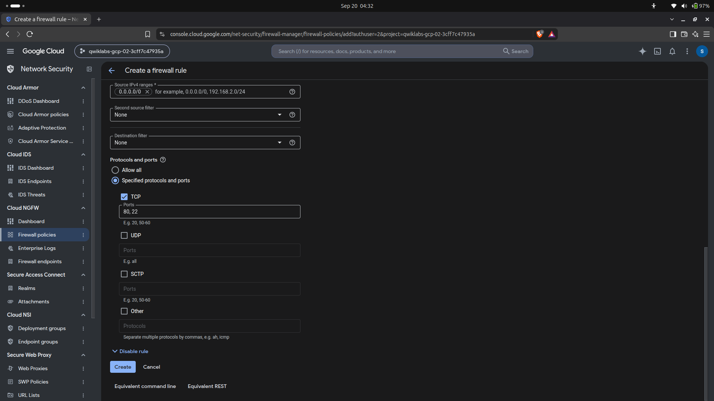
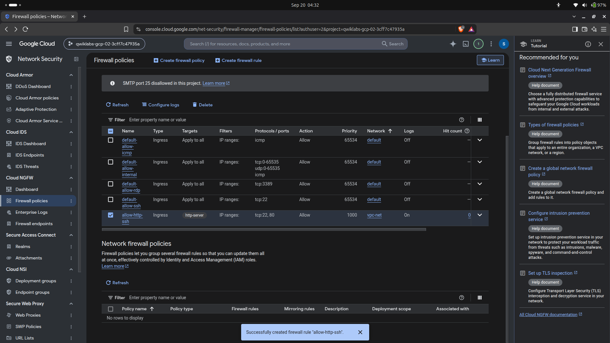
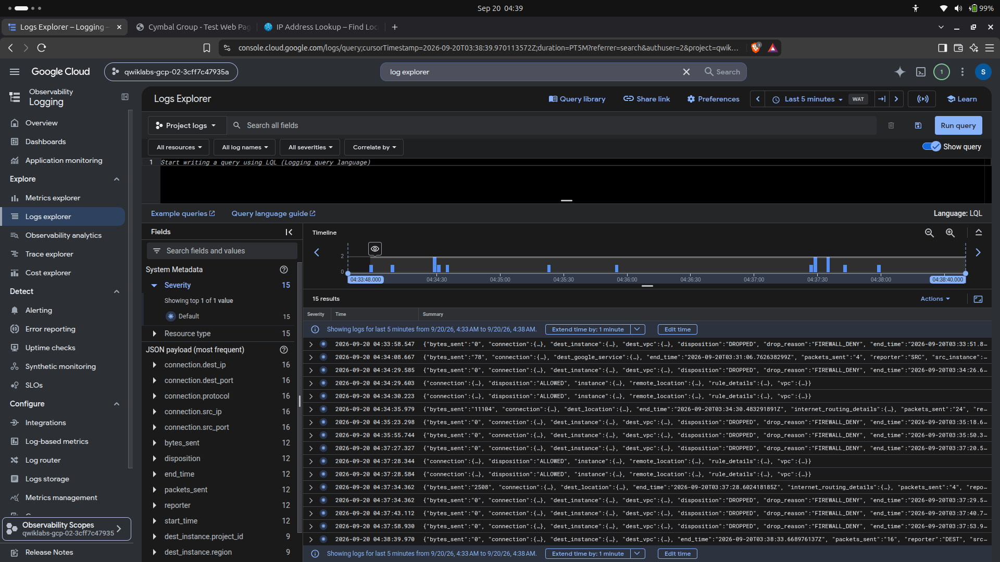
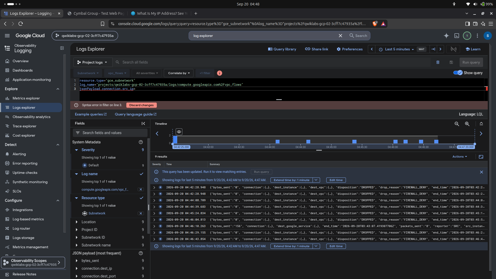
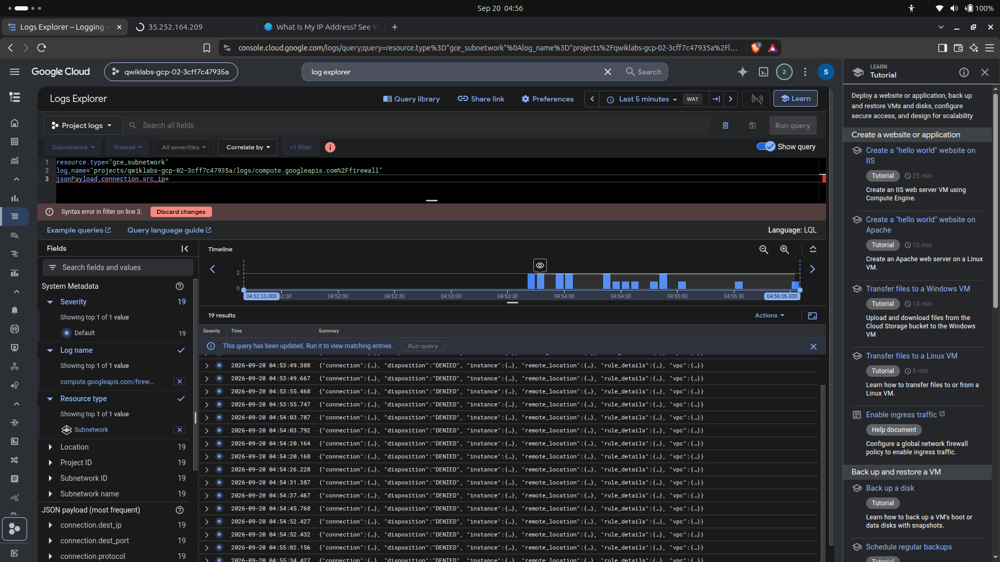

# Configuring and Verifying VPC Firewall Rules in Google Cloud

**Author:** Muhammed Abdulazeez  
**Role:** Cybersecurity Instructor (Aptech Akowonjo, Lagos) | Cloud Security Transition  
**Platform:** Google Cloud Skills Boost — *Cloud Security Risks: Identify and Protect Against Threats*  
**Lab:** Access a Firewall and Create a Rule

---

## Overview

This project documents a hands-on Google Cloud lab in which I configured, tested, and verified **VPC firewall rules** against a live web server — then used **Cloud Logging (Logs Explorer)** to independently confirm the firewall's real-world behavior at the packet level.

The scenario is built around **Cymbal Bank**, a fictional retail bank with a demo web server running on an existing VPC. As the cloud security analyst on this task, my job was to:

1. Analyze the network's default firewall posture
2. Create a firewall rule allowing controlled HTTP/SSH access to the web server
3. Generate real traffic and verify it in VPC Flow Logs
4. Create a second, conflicting rule to **deny** that same traffic
5. Verify the deny rule's enforcement independently through Firewall Rule logs

This mirrors a task that comes up constantly in real cloud security work: locking down a server's exposure to only the traffic it actually needs, and then **proving** — not assuming — that the configuration behaves as intended.

---

## Step 1 — Reviewing the Default Firewall Posture

Before making any changes, I reviewed the VPC's existing firewall rules under **Network Security → Firewall policies**.

The project's default rules: `default-allow-icmp`, `default-allow-internal`, `default-allow-rdp`, and `default-allow-ssh` — all applying broadly (`Apply to all`) at the lowest priority (`65534`).

**Key observation:** Google Cloud's stated default behavior is that **all incoming traffic is blocked unless a rule explicitly allows it.** The default rules shown here are the exceptions Google pre-provisions (ICMP, internal traffic, RDP, SSH) — not evidence that the network is open. Anything not explicitly allowed — including HTTP on port 80 — was blocked before I made any changes.

This step matters because in real environments, you should never assume you know a network's security posture — you verify it first.

---

## Step 2 — Creating an Allow Rule for HTTP and SSH

**Navigation:** `Network Security → Firewall policies → Create firewall rule`

Rather than applying this rule broadly, I scoped it precisely using a **target tag**, so it would affect only the web server — not every VM on the network.

| Setting | Value |
| :--- | :--- |
| **Name** | `allow-http-ssh` |
| **Logs** | On |
| **Network** | `vpc-net` |
| **Priority** | `1000` |
| **Direction** | Ingress |
| **Action on match** | Allow |
| **Targets** | Specified target tags |
| **Target tags** | `http-server` |
| **Source IPv4 ranges** | `0.0.0.0/0` |
| **Protocols/ports** | TCP — ports `80, 22` |

Scoping the rule to `http-server` tagged instances only, at priority `1000` — well above the default rules' priority of `65534`, meaning this rule is evaluated first.

Restricting the rule to TCP traffic on ports `80` (HTTP) and `22` (SSH) specifically — not "allow all," which would defeat the purpose of the rule.

**Why target tags instead of "all instances"?** Target tags let a firewall rule apply to a specific subset of VMs rather than the entire VPC. This is least-privilege applied at the network layer: only instances explicitly tagged `http-server` are affected by this rule, so adding new VMs to the network later doesn't silently inherit this exposure.

**Result:**

The rule appears in the firewall rules table — Ingress, target `http-server`, ports `tcp:22, 80`, Allow, priority `1000`, network `vpc-net`, logging On.

---

## Step 3 — Generating Traffic and Verifying with VPC Flow Logs

With the allow rule in place, I generated real HTTP traffic by visiting the web server's external IP directly in the browser, then moved to **Logs Explorer** to confirm the connection was actually allowed — not just assume it based on the rule existing.

Querying `compute.googleapis.com/vpc_flows` for the subnetwork resource. Results show a mix of `"disposition":"ALLOWED"` and `"disposition":"DROPPED","drop_reason":"FIREWALL_DENY"` entries — confirming the firewall was actively evaluating and enforcing rules against real traffic in near real time.

**A note on troubleshooting (and why it's included here):** While refining the query to filter by my own source IP, I hit a syntax error:

*"Syntax error in filter on line 3"* — the query `jsonPayload.connection.src_ip=` was left without a completed value, which Logging's query language (LQL) correctly rejected rather than silently returning wrong results.

I'm including this screenshot deliberately rather than only the clean, working queries. Real security analyst work involves debugging log queries constantly, and a tool that fails loudly on a malformed filter (instead of quietly returning nothing) is a good thing — it forced a review of the query syntax rather than a false "no traffic found" conclusion.

---

## Step 4 — Creating a Conflicting Deny Rule

To test how Google Cloud firewall rules behave when they **overlap**, I created a second rule targeting the same tagged instance, this time denying HTTP traffic outright:

| Setting | Value |
| :--- | :--- |
| **Name** | `deny-http` |
| **Action on match** | Deny |
| **Targets** | Specified target tags → `http-server` |
| **Source IPv4 ranges** | `0.0.0.0/0` |
| **Protocols/ports** | TCP — port `80` |

At this point, the `http-server` tagged VM had **two active rules:** `allow-http-ssh` (allowing port 80) and `deny-http` (denying port 80). This is intentional — it's a realistic simulation of how firewall misconfigurations actually happen in production: multiple rules stacking on the same target without an obvious single "cause" of a given traffic decision.

---

## Step 5 — Verifying Enforcement Through Firewall Rule Logs

After adding the deny rule, attempting to reach the web server over HTTP failed as expected. I confirmed this at the log level rather than relying on the browser error alone:

Querying the `compute.googleapis.com/firewall` log against the subnetwork resource. All 19 results in this window show `"disposition":"DENIED"` — direct evidence that the `deny-http` rule was actively intercepting and blocking the connection attempts.

**What this proves:** Google Cloud firewall rules are evaluated by **priority**, not by creation order. Because `deny-http` was scoped precisely to the tagged instance and matched the traffic in question, it took effect immediately — demonstrating that "having an allow rule" is not the same as "traffic is actually allowed" once a more specific or competing rule enters the picture. In a real environment, this is exactly the kind of layered rule interaction that causes "but I already opened that port" support tickets — and exactly why verifying against logs, not just the rules table, is the correct way to confirm a firewall's actual behavior.

---

## Key Concepts Demonstrated

- **Least Privilege at the Network Layer** — using target tags to scope rules to specific VMs instead of the entire VPC
- **Firewall Rule Priority** — understanding that lower numbers evaluate first, and that overlapping rules can silently change a resource's effective exposure
- **VPC Flow Logs vs. Firewall Rule Logs** — Flow Logs show the traffic pattern; Firewall Rule Logs show why a specific connection was allowed or denied
- **Log-Based Verification** — never assuming a configuration works because it "looks right" in the console; confirming it against the actual traffic logs
- **Query Debugging in LQL** — working through a real syntax error rather than only presenting clean, successful queries

---

## Real-World Application

This workflow mirrors situations that come up constantly in cloud security operations:

- Investigating *"why can't I connect"* tickets that turn out to be a competing firewall rule, not a missing one
- Locking down a newly deployed server to only the ports it actually needs, using tag-based targeting instead of broad IP ranges
- Producing log-backed evidence for an audit or incident report — showing that traffic was blocked, not just asserting it based on the rule configuration

---

## Tools Used

- Google Cloud Console — Network Security / Firewall Policies
- Google Cloud VPC Firewall Rules
- Google Cloud Logs Explorer (Cloud Logging)
- Logging Query Language (LQL)
