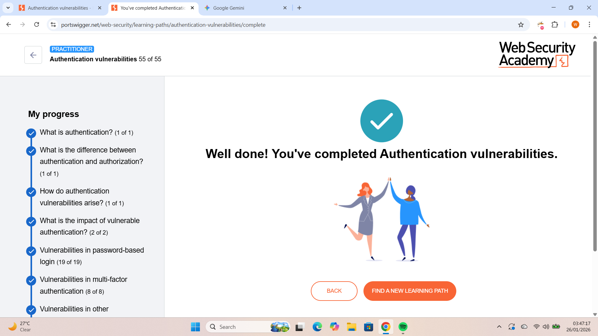
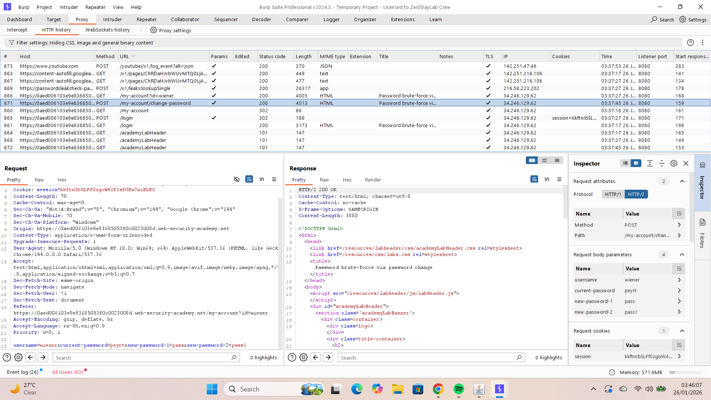

# 📔 Web Hack Diaries: Day 3 – The Authentication Frontier

**Source:** PortSwigger Academy  
**Texter:** Muhammed Abdulazeez

This documentation summarizes My deep dive into the flaws, exploits, and defenses of modern web authentication. Today’s session focused on how "secure" mechanisms like hashing, 2FA, and password resets fail when implemented with flawed logic.

---

## 🛠️ Core Vulnerabilities & Exploits

### 🏗️ 1. Weak Password Storage & Cookie Handling

When authentication is "lazy," developers often store credentials or hashes directly in cookies.

#### How to Find it (Step-by-Step):

1. **Identify Cookies:** Log in and check your browser’s DevTools (Storage tab) or Burp Suite. Look for cookies like `stay-logged-in` or `remember-me`.
2. **Decode:** Most cookies are **Base64** encoded. Paste the value into Burp Decoder.
3. **Pattern Match:** Look for patterns like `username:hash`. If the hash is 32 characters, it’s likely **MD5**.
4. **Reverse the Hash:** Take the hash and paste it into a search engine or a site like CrackStation. If it reveals your password, the system is unsalted and weak.

#### Protection:

- **Slow Hashing:** Use `bcrypt`, `scrypt`, or Argon2.
- **Salting:** Add a unique, random string to every password before hashing.
- **Session Tokens:** Never store credentials in a cookie. Store a random **UUID** (Session ID) that points to a user record in a secure database.

---

### 🔑 2. Password Reset IDOR & Logic Flaws

The reset page is often the weakest link because it allows a "password change" without knowing the "old password."

#### How to Find it (Step-by-Step):

1. **Trigger a Reset:** Request a reset for your account.
2. **Inspect the URL:** Look for parameters like `temp-forgot-password-token` or `username=wiener`.
3. **The "Ghost Token" Test:** Capture the final password submission request in Burp. Delete the token value and change the `username` to `carlos`.
4. **The Result:** If the server changes Carlos’s password despite the missing/mismatched token, the logic is broken.

#### Protection:

- **Atomic Validation:** The `POST` request to change the password **must** require a valid token.
- **Token Mapping:** The server must verify that `Token A` belongs strictly to `User A`

---

### 🧪 3. Password Reset Poisoning (Host Header)

This uses the server's own logic to "kidnap" a reset link.

#### How to Find it (Step-by-Step):

1. **Intercept Reset Request:** Capture the `POST /forgot-password` request where you enter a username.
2. **Inject Headers:** Add or modify the `X-Forwarded-Host` header to point to your **Exploit Server** or Burp Collaborator.
3. **Check Logs:** Check your server logs. If you see an incoming request containing a token, the target server used your injected header to build the link in the victim's email.
4. **The Takeover:** Use that stolen token on the *real* website to reset the victim's password.

#### Protection:

- **Whitelist Hosts:** Validate the `Host` header against a list of permitted domains.
- **Static Base URLs:** Hardcode the website's URL in the application configuration rather than building it dynamically from headers.

---

### 📊 4. Username Enumeration & Timing Attacks

Revealing whether a user exists is the first step of a targeted attack.

#### How to Find it (Step-by-Step):

1. **Message Analysis:** Try to log in with a fake user. Does it say "Invalid User" vs. "Invalid Password"?
2. **Timing Analysis:** In Burp Intruder, send a list of 100 usernames. Sort by the "Time" column.
3. **The Result:** If "admin" takes 200ms to process while "fakeuser" takes 10ms, the server is leaking that "admin" exists because it is spending time hashing a password for a valid account.

#### Protection:

- **Generic Messaging:** Always return "Invalid username or password."
- **Constant-Time Validation:** Perform a "dummy" hash calculation even if the username is not found so the response time is always the same.

---

### 🛡️ 5. Brute-Force & Rate Limiting Bypasses

Attackers use automated scripts to guess passwords until they get in.

#### How to Find it (Step-by-Step):

1. **Baseline Test:** Use Burp Intruder to send 100 login attempts. See if you get a 403 Forbidden or a CAPTCHA.
2. **IP Rotation Test:** Add headers like `X-Forwarded-For: 1.1.1.1`, then `1.1.1.2`. See if this resets the "attempt counter."
3. **The "Lather, Rinse, Repeat" Test:** Try 3 wrong passwords for Carlos, then 1 **correct** login for your own account. Check if logging in as yourself "clears" the strike count against your IP.

#### Protection:

- **Account Lockout:** Lock the account after X failed attempts (with an easy unlock via email).
- **Exponential Backoff:** Increase the wait time between failed attempts (1s, 2s, 4s, 8s...).

---

### 📱 6. Multi-Factor Authentication (MFA) Bypasses

MFA is only secure if the application enforces it on every request.

#### How to Find it (Step-by-Step):

1. **The "Forced Browsing" Test:** Log in with a password. When the 2FA screen appears, **don't enter a code.** Instead, manually type `/my-account` or `/admin` in the URL bar.
2. **Response Manipulation:** Submit a wrong 2FA code. Use Burp to intercept the response and change `{"success":false}` to `{"success":true}`.
3. **OAuth Misconfiguration:** If the site uses "Sign in with Google," check if you can change the email parameter to a victim’s email during the callback.

#### Protection:

- **MFA State Enforcement:** The server must check `is_mfa_authenticated == true` on every single protected page, not just the login page.
- **TOTP Apps:** Favor Authenticator apps over SMS to prevent SIM swapping.

---

## 📔 Summary of Day 3

I have moved from simple password guessing to logic-based exploitation. I learned that you don't always need to "crack" a password if you can trick the server into ignoring the check entirely.

