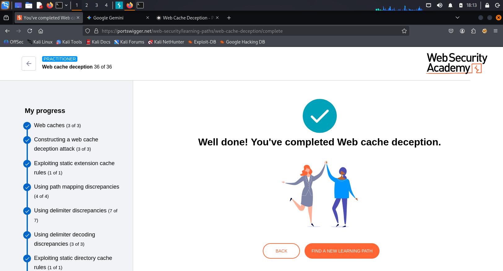
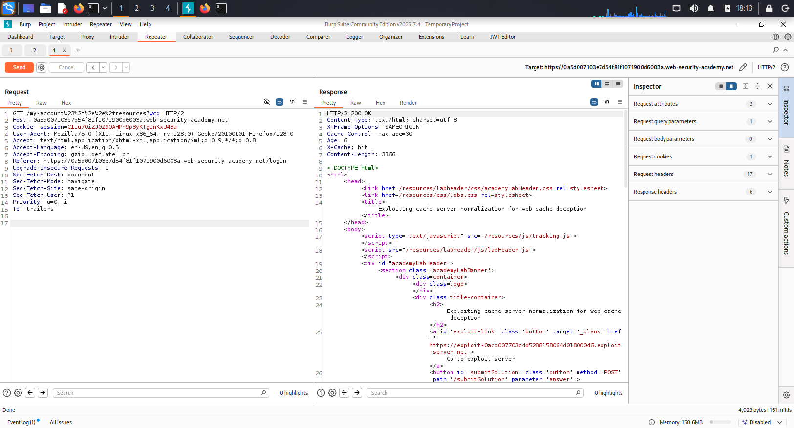

# 📔 Web Hack Diaries: Part 1

**Topic:** Web Cache Deception (WCD)  
**Source:** PortSwigger Academy  
**Focus:** Path Mapping, Delimiters, and Normalization Discrepancies  
**Texter:** Muhammed Abdulazeez



---

## Executive Summary

**Web Cache Deception** occurs when an attacker tricks a web cache into storing sensitive, dynamic content (like user profiles or settings) as if it were a public, static resource (like a CSS or Image file). This happens because the **Origin Server** and the **Cache Server** interpret the same URL in different ways.

---

## Core Vulnerability: The "Discrepancy"

The attack relies on a disagreement between two systems:

| System | Goal | Typical Behavior |
| :--- | :--- | :--- |
| **Origin Server** | Deliver Data | Often "forgiving." It ignores junk at the end of a URL to ensure the user gets the page they want. |
| **Web Cache** | Save Bandwidth | Often "literal." It looks at the file extension or path prefix to decide if a file is public. |

---

## Attack Vectors & Methodology

### A. Path Mapping Discrepancy

The attacker adds a static extension to a dynamic URL.

- **Payload:** `/my-account/wcd.css`
- **Server sees:** `/my-account` (ignores the `.css`).
- **Cache sees:** A CSS file (stores it).
- **Outcome:** Private account data is stored in the public cache.

### B. Delimiter Discrepancy

Using characters like `;`, `?`, or `#` to "cut off" the path for the server but keep it visible for the cache.

- **Payload:** `/profile;foo.css`
- **Java Spring Server:** Sees `;` as a delimiter; interprets path as `/profile`.
- **Standard Cache:** Sees `;` as part of the filename; interprets path as `/profile;foo.css`.

### C. Normalization Discrepancy (Path Traversal)

The most powerful method. It uses encoded "go back" commands (`..%2f`) to hide the target inside a "safe" folder.

- **Payload:** `/assets/..%2fmy-account`
- **Smart Server:** Normalizes the path to `/my-account`.
- **Literal Cache:** Sees the `/assets/` prefix and applies a "Cache All" rule.

---

## Exploitation Steps (The "Attacker's Playbook")

1. **Identify Target:** Find a page containing sensitive data (e.g., `/settings`).
2. **Test Server Abstraction:** Check if `/settings/any-junk` still returns the settings page.
3. **Test Cache Rules:** Add `.css` or `.js` and look for `X-Cache: hit` in headers.
4. **Confirm Normalization:** Try `/static/..%2fsettings`. If it returns settings with a cache hit, the site is vulnerable.
5. **Craft the Payload:**
   ```html
   <script>document.location="https://target.com/my-account%23%2f%2e%2e%2fresources?wcd"</script>
   ```
6. **Harvest:** After the victim visits the link, the attacker accesses the same URL to download the cached data.

---

## Prevention & Mitigation (Hardening the Architecture)

Preventing Web Cache Deception requires a "Defense in Depth" approach. You cannot rely on just one fix; you must ensure the Cache and the Origin Server are speaking the exact same language.

### A. The "Golden Rule": Cache-Control Headers

The most effective defense is to tell the cache explicitly what to do. If the server tells the cache "Do not save this," the cache must obey, regardless of what the URL looks like.

- `Cache-Control: no-store`: This is the nuclear option. It tells the cache never to save the response under any circumstances. Use this for all pages containing sensitive data.
- `Cache-Control: private`: This tells the cache that the response is intended for a single user and should not be stored in a shared (public) cache.

---

### B. Web Server Configuration (Origin Side)

The Origin Server must be "strict" about how it maps URLs to resources.

1. **Disable Path Abstraction:** Configure your server (e.g., Apache, Nginx, or Spring) so that it does not ignore trailing segments.
   - *Bad:* `/profile/junk.css` returns the profile.
   - *Good:* `/profile/junk.css` returns a **404 Not Found**.
2. **Use `X-Content-Type-Options: nosniff`:** This prevents the browser (and some caches) from "guessing" the file type. If the server says the content is `text/html`, the cache shouldn't try to treat it as `text/css` just because the URL ends in `.css`.

---

### C. Cache Server Configuration (Edge Side)

The Cache needs to be smarter about what it considers a "Static Asset."

1. **Verify Content-Type:** Do not cache based on the URL extension alone. Configure the cache to only store a file if the `Content-Type` header actually matches (e.g., only cache `.js` files if the header is `application/javascript`).
2. **Match Static Directories Strictly:** Instead of caching anything that *starts* with `/assets/`, ensure the cache only stores files that physically exist in that directory.
3. **Synchronize Normalization:** Ensure the Cache and the Server use the same logic for:
   - Decoding URL-encoded characters (like `%2f`).
   - Resolving dot-segments (like `../`).
   - Handling delimiters (like `;` and `#`).

---

### D. Architectural Fixes

If you can change the way the site is built, these methods are highly effective:

- **Store Static Assets on a Different Domain:** Use a dedicated domain (like `static-example.com`) for all your CSS, JS, and images. Since this domain will never host a `/profile` page, there is no private data to "deceive" the cache with.
- **Avoid Path-Based Cache Rules:** Use query parameters for versioning (e.g., `style.css?v=1.2`) instead of placing files in directories that might be vulnerable to path traversal.

---

## Summary Comparison: Vulnerable vs. Secure

| Feature | Vulnerable Setup | Secure Setup |
| :--- | :--- | :--- |
| **Header Logic** | Relies on default settings. | Uses `Cache-Control: no-store` for private data. |
| **URL Parsing** | Server ignores "junk" at the end of URLs. | Server returns `404` for invalid path segments. |
| **File Identification** | Cache trusts the URL extension (`.css`). | Cache verifies the `Content-Type` header. |
| **Normalization** | Discrepancy between Cache and Server. | Both systems normalize URLs identically. |

---

## 📔 Appendix: Common Delimiter Reference

| Character | URL Encoded | Usage |
| :--- | :--- | :--- |
| **Semicolon** | `%3b` | Used for Matrix Variables (Java Spring). |
| **Dot** | `%2e` | Used to separate filenames and extensions. |
| **Question Mark** | `%3f` | Separates the path from the query string. |
| **Hash/Fragment** | `%23` | Separates path from client-side fragments. |
| **Null Byte** | `%00` | Historically used to terminate strings in C/PHP. |


