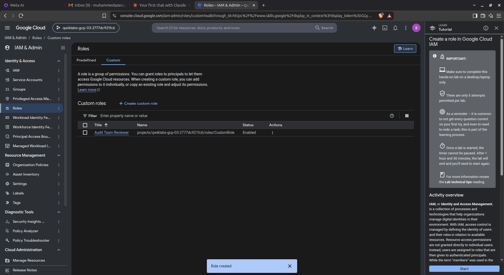

# Implementing Least-Privilege Access Control with Google Cloud IAM Custom Roles

**Author:** Muhammed Abdulazeez  
**Role:** Cybersecurity Instructor (Aptech Akowonjo, Lagos) | Cloud Security Transition  
**Platform:** Google Cloud Skills Boost — *Cloud Security Risks: Identify and Protect Against Threats*  
**Lab:** Create a Role in Google Cloud IAM

---

## Overview

This project documents a hands-on Google Cloud IAM lab in which I designed and implemented a **custom, least-privilege IAM role** for a simulated third-party audit scenario. The exercise reflects a real-world cloud security task: granting external auditors precisely the access they need to complete a compliance review — no more, no less.

The scenario is built around **Cymbal Bank**, a fictional retail bank migrating workloads to Google Cloud. One of its cloud deployments stores sensitive customer billing and invoice data in a Firebase database. Before that database can go live, it must pass a third-party audit, and the audit team needs read-only access to complete it.

As the cloud security analyst on this task, my job was to:

1. Create a custom IAM role scoped to exactly what the audit team needs
2. Grant that role to the auditor's account
3. Verify the access was correctly and precisely applied

---

## Why a Custom Role (Not Basic or Predefined)

Google Cloud offers three types of IAM roles, and choosing the right one is itself a security decision:

| Role Type | Description | Why It Didn't Fit Here |
| :--- | :--- | :--- |
| **Basic roles** | Owner, Editor, Viewer — broad, historical roles | Far too permissive; "Viewer" would expose more than the database review requires |
| **Predefined roles** | Google-curated roles scoped to specific services | Didn't match this exact combination of permissions needed |
| **Custom roles** | Roles you define permission-by-permission | ✅ Used here — lets permissions be scoped to *exactly* what the task requires |

This directly applies the **principle of least privilege**: every principal should be granted the minimum access necessary to perform their function, and nothing more. Over-permissioning auditors — even temporarily — creates unnecessary risk and a compliance liability in its own right.

---

## Step-by-Step Implementation

### Task 1 — Create the Custom Role

**Navigation:** `IAM & Admin → Roles → + Create Role`

The role was configured with the following properties:

| Property | Value |
| :--- | :--- |
| **Title** | Audit Team Reviewer |
| **Description** | Custom role allowing the audit team to conduct its review activities. Grants read-only access to Firebase database resources. |
| **ID** | CustomRole |
| **Role launch stage** | General Availability |

**Why General Availability?** Google Cloud custom roles can be flagged at different maturity stages:

- **Alpha** — experimental, not recommended for production
- **Beta** — more stable, but still subject to change
- **General Availability (GA)** — fully tested, stable, and appropriate for production use

Since this role would be used in a real audit workflow (not a test), **GA** was the correct choice.

**Permissions added to the role:**

| Permission | Purpose |
| :--- | :--- |
| `Firebase Realtime Database Viewer` | Grants read access to the actual data stored in the database |
| `firebase.clients.list` | Allows viewing which clients are connected to the database |
| `firebasedatabase.instances.list` | Allows viewing which database instances exist |

Together, these three permissions give the audit team full visibility into the database's structure and contents — **and nothing else**. No write, delete, or configuration permissions were included, so the auditors cannot modify anything they're reviewing.

**Result:** Role successfully created and enabled in the project.

*The custom "Audit Team Reviewer" role, shown as Enabled under IAM & Admin → Roles → Custom.*

---

### Task 2 — Grant the Role to a User

**Navigation:** `IAM & Admin → IAM → Grant Access`

Steps taken:

1. Entered the auditor's principal (username) into the **New principals** field
2. Selected **Custom → Audit Team Reviewer** from the role dropdown
3. Saved the binding

This step applies a core IAM pattern covered earlier in the certificate track:

> **Principal + Role + Allow Policy = Access Granted**

The principal (the auditor's account) was bound to the role (Audit Team Reviewer), which in turn carries the specific permission set defined in Task 1. No permissions were granted to the individual directly — everything flows through the role, which is itself IAM best practice, since it makes access easy to audit, reuse, and revoke.

---

### Task 3 — Verify the Role Was Granted

**Navigation:** `IAM & Admin → Policy Analyzer → Custom Query`

Rather than simply trusting that the previous steps worked, this task required **independent verification** — a habit that matters in real security work, where configuration mistakes are a leading cause of cloud breaches.

Steps taken:

1. Created a custom query with **Parameter 1 → Principal**
2. Entered the auditor's username as the query subject
3. Enabled **"List resources within resource(s) matching your query"**
4. Ran the query

**Query result:** The auditor's account was confirmed to hold the **Audit Team Reviewer** role — matching exactly what was configured in Tasks 1 and 2, with no extra or missing permissions.

This is functionally the same output as a **Role Binding Report** — a tool used in real cloud security operations to audit who has access to what, typically as part of quarterly IAM reviews or compliance attestations.

---

## Key Concepts Demonstrated

- **Least Privilege Principle** — permissions scoped to the exact task, nothing broader
- **Custom IAM Roles** — building precisely-scoped access when predefined roles don't fit
- **Role Launch Stages** — understanding Alpha/Beta/GA and why GA was appropriate here
- **Principal–Role–Policy binding** — the core pattern behind all Google Cloud access control
- **Access Verification** — using Policy Analyzer to confirm configuration rather than assuming it worked
- **Compliance-Driven Access Control** — modeling a real audit/compliance scenario, not just a technical exercise

---

## Real-World Application

This exact workflow mirrors situations that come up constantly in cloud security roles, including:

- Granting **external auditors** temporary, scoped access for regulatory reviews (e.g., CBN-mandated audits for Nigerian financial institutions)
- Providing **third-party vendors** or contractors with limited access for a specific engagement
- Reducing the blast radius of a compromised account by ensuring no principal — human or automated — holds more access than their role requires

Getting this right is not just a technical exercise; it directly supports an organization's ability to pass audits, satisfy regulators, and reduce the risk and cost of a potential breach.

---

## Tools Used

- Google Cloud Console (IAM & Admin)
- Google Cloud IAM — Custom Roles
- Google Cloud Policy Analyzer

*This project was completed as part of the Google Cloud Cybersecurity Certificate (Google Skills Boost) — Course: Cloud Security Risks: Identify and Protect Against Threats.*
